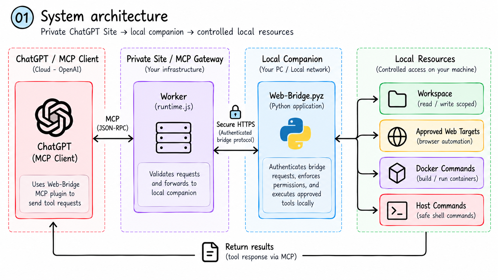
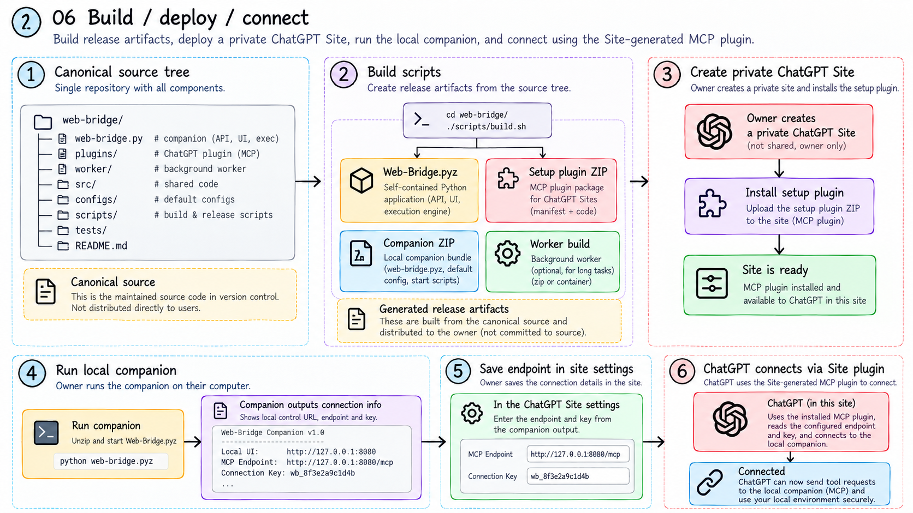
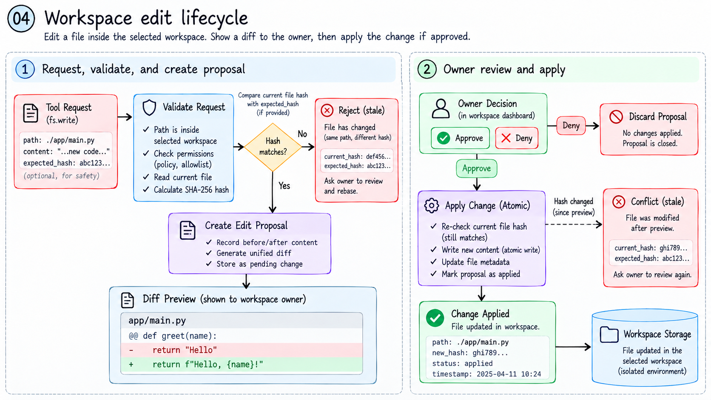
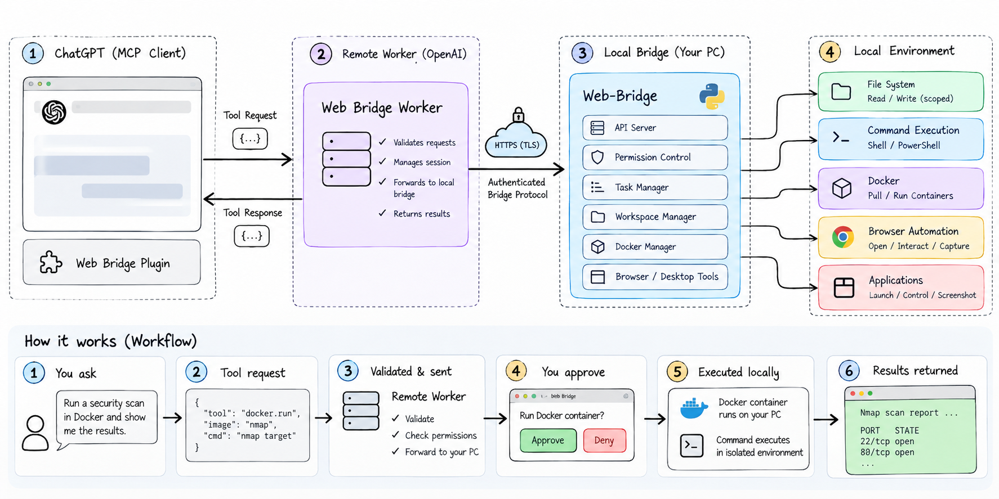
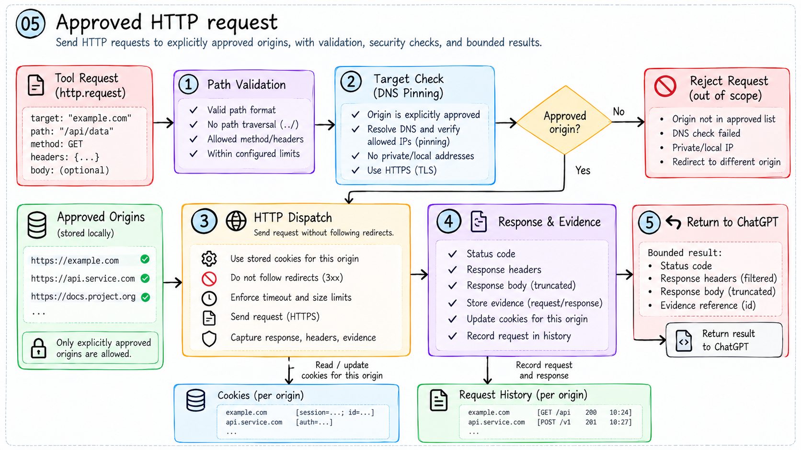

# Localize (Web-Bridge)

**Connect ChatGPT to your project, with permissions controlled on your computer.**

Version **3.2.0** · Setup plugin **1.2.0** · Created by [admin12121](https://github.com/Admin12121) · [MIT license](LICENSE)

Read and update files, run approved host or Docker commands, connect selected skills/MCP applications, and save work for later continuation. A private Site forwards authenticated calls to the local Python companion. The local control panel selects the project and grants access.

Complete setup has four steps: **[install locally](#install-once-then-run-localizeit) → [publish your private Site](#publish-your-private-site) → [install its ChatGPT plugin](#install-the-generated-chatgpt-plugin) → [connect and verify](#connect-your-computer-and-verify)**. The local installer completes the first step. New users must also complete the Site and plugin setup below.




## Install once, then run `localizeit`

**Windows PowerShell:**

```powershell
irm https://github.com/Admin12121/Localize/releases/download/v3.2.0/install.ps1 | iex
```

**macOS / Linux:**

```sh
curl -fsSL https://github.com/Admin12121/Localize/releases/download/v3.2.0/install.sh | sh
```

After installation, open a new terminal once and run from any folder:

```sh
localizeit
```

The installer prepares uv if needed, verifies the GitHub wheel against the release SHA-256 manifest, installs a managed Python environment, checks the installed command and updates your user's command path. No administrator access, repository clone, Node.js, PyPI account or npm account is required. It prints what it is doing and stops on a failed download, checksum or installation. You can [inspect the Windows installer](scripts/install.ps1) or [macOS/Linux installer](scripts/install.sh) before running it. Re-run the installer to repair or replace this version.

`localizeit` opens the local panel and starts the authenticated tunnel. It reuses an installed cloudflared, or downloads the official release into a private user cache and verifies its published SHA-256 before use. Automatic tunnel preparation supports Windows x64, macOS Intel/Apple Silicon, and Linux x64/arm64; other architectures can use an existing supported cloudflared installation. Docker must be installed and running separately only when you choose Docker execution.

Use `localizeit --local-only` for local controls without a tunnel/download. `localizeit --about` and `localizeit --help` also skip tunnel preparation. `localize` remains an optional alias; `web-bridge` is the legacy command with its explicit `--tunnel` behavior. Existing Web-Bridge 3.2 runtime state remains compatible.

For users who already have uv, the direct alternative is:

```sh
uv tool install https://github.com/Admin12121/Localize/releases/download/v3.2.0/localizeit-3.2.0-py3-none-any.whl
uv tool update-shell
```

Open a new terminal once, then run `localizeit`.

The primary package and command are both **`localizeit`**. Distribution uses [GitHub Releases](https://github.com/Admin12121/Localize/releases/tag/v3.2.0); bare `uvx localizeit` searches PyPI and is not the installation route. Individual release assets have SHA-256 checksums in `SHA256SUMS`. To remove the installed commands later, use `uv tool uninstall localizeit`; saved project configuration remains in your per-user runtime folder.

## Publish your private Site

This is a one-time setup in your own ChatGPT account. The Site hosts the bridge gateway; publishing it with MCP support creates its associated ChatGPT plugin. The local installer does not publish a Site, and this release has no `localizeit deploy` command or one-click private-Site installer.

### First-time setup

1. Download [web-bridge-setup-plugin.zip from the GitHub release](https://github.com/Admin12121/Localize/releases/download/v3.2.0/web-bridge-setup-plugin.zip).
2. Open **ChatGPT Work on the web**, or **Codex in the ChatGPT desktop app**, in the account/workspace that should own the Site. Use a chat with **Sites publishing and file/build tools** available. You can mention **@Sites**; Plugin Creator can also route a custom-tools request through Sites when available. Account/workspace permissions determine availability. See [OpenAI's Sites guide](https://learn.chatgpt.com/docs/sites) and [custom MCP setup guide](https://learn.chatgpt.com/docs/extend/mcp).
3. **Attach the downloaded ZIP to that chat as project source**, then send the prompt below. The archive contains the gateway source and the `setup-web-bridge` skill. Attaching or installing this setup archive alone does not deploy the gateway or install its generated tools plugin.

   ```text
   Use the attached Web-Bridge setup ZIP to deploy my private bridge website.
   Extract the archive and follow skills/setup-web-bridge/SKILL.md.
   Build and validate the bundled source instead of rebuilding the app from scratch.
   Create a Site owned by my account with MCP support, provision fresh runtime
   secrets without showing their values in chat, and publish the Site privately.
   Return the live Site URL and show the installation/connection card for the
   canonical plugin generated by that Site. Do not create a second wrapper plugin.
   If the required Sites or build tools are unavailable, explain what is missing.
   ```

4. Follow any publication prompts shown by ChatGPT. If the builder stops at a preview, ask **"Publish this Site privately in my account."** A preview or saved version alone is not the finished deployment. Ask the builder to confirm successful publication and provide the live URL.
5. Save that **live Site URL**. It is the connection page you will use in the steps below. You can find your own deployed Sites later at [chatgpt.com/sites](https://chatgpt.com/sites). Do not use the project author's Site URL or copy someone else's Site identity or credentials.

**Expected result:** your own published private Site and its generated plugin's install/connect card. If no live URL was returned, deployment is still incomplete. If the chat cannot access Sites publishing or build tools, use an eligible Work/Codex session or ask your workspace admin to check access; the local installer cannot enable those account capabilities.

### Upgrade an existing Site

Reuse your existing Site if you have already created one. Open its original builder chat, or a Sites-enabled Work/Codex chat, attach the new setup ZIP, and send:

```text
Update my existing Web-Bridge Site at <paste my existing Site URL> using the
attached release ZIP. Verify that I own or can edit that Site before changing it.
Preserve its Site/App/plugin identity, database, runtime secrets and connection
settings. Keep its existing audience unchanged. Build and validate the new
gateway, publish the update to that same Site, and return the live URL plus its
existing canonical plugin's installation/connection card if needed.
Do not create a replacement Site or plugin.
```

Republishing the Site refreshes its generated plugin's tool list. If the plugin is already installed, start a new ChatGPT chat after publication and verify the updated tools. Updating `localizeit` or downloading a new GitHub release does not upgrade an existing hosted gateway.

## Install the generated ChatGPT plugin

Complete Site publication first; the generated plugin comes from that deployment.

1. In the builder chat, use the Site-generated plugin card and select **Install** (or the plus button), then **Connect** if prompted. If it says **Already installed**, continue to the connection steps below.
2. If the card is missing, ask the builder: **"Retrieve this Site's generated plugin connection and show its install/connect card."** You can also open **Plugins → Personal**, look under your created plugins for the Site's name, and choose **Install** or **Connect**. A shared deployment may appear under your workspace or **Shared with me** instead.
3. Start a **new ChatGPT chat**. Type `@`, search for your Site/plugin's name, and select it under Plugins. Installation makes its tools available; the local companion still needs to be connected separately.

Use the plugin generated by your Site rather than creating another manual MCP wrapper. See [OpenAI's plugin installation instructions](https://learn.chatgpt.com/docs/plugins#install-and-use-a-plugin). Installing the setup ZIP is not a substitute for this step.

## Connect your computer and verify

1. Run `localizeit` on the computer containing your project and keep its terminal open.
2. Open the printed **LOCAL CONTROL PANEL** URL and enter the **LOCAL CONTROL CODE**. Select your project and permissions, then choose host or Docker execution, shell and timeouts. Host commands require exact local approval for each command.
3. Open **your published private Site URL** from the previous section. Choose **Connect ChatGPT** to open its connection form. Copy the terminal values into these fields:

   | Terminal value | Where it goes |
   | --- | --- |
   | `LOCAL CONTROL CODE` | Only the local control panel on your computer |
   | `SITE ENDPOINT` | The private Site's **Companion endpoint** field; keep the printed `/mcp` suffix |
   | `SITE CONNECTION KEY` | The private Site's **Site connection key** field |

4. Select **Save connection**, then **Test companion**. Both controls are on the private Site. Keep codes and keys out of chat, screenshots and shared files. Never enter the local control-panel URL as the remote endpoint or expose that panel through the tunnel.
5. In a new ChatGPT chat, select the installed plugin with `@` and send:

   ```text
   Use this bridge. Call bridge_status once and show my selected project,
   environment and permissions. Read a known file I identify, then submit a
   harmless command for local approval. Inspect its actual result before
   saying it completed. Focus on my project rather than exploring bridge internals.
   ```

**Setup is verified only after** the Site's companion test succeeds and ChatGPT can make an approved real tool call against the selected project. Plugin installation alone does not prove the local connection works. If the Site asks for a missing connection, return to its connection form; if the plugin is unavailable, return to the generated-plugin installation step.

For everyday use, run `localizeit`, select your project/grants locally, and use your installed plugin in ChatGPT. There is no need to create or publish another Site for each chat. Quick Tunnel URLs can change after a restart: update the endpoint in the same private Site, leaving the key field blank only when retaining the unchanged saved key. The standalone `.pyz` alternative is not needed for this installer-based workflow.



## Platform requirements

| Platform | Installer requirements |
| --- | --- |
| Windows 10/11 | Built-in Windows PowerShell 5.1+ and HTTPS access to GitHub/Astral |
| macOS Intel / Apple Silicon | Built-in `sh` and `curl`, plus HTTPS access to GitHub/Astral |
| Linux x64 / arm64 | `sh`, `curl`, and `sha256sum` or `shasum`, plus HTTPS access to GitHub/Astral |

The installer selects Python **3.12** automatically; you do not need to find a Python script or manage a virtual environment. Install and run as your regular user. Windows ARM requires an existing supported cloudflared installation for tunnel use.

Docker is optional. For Docker execution, start Docker Desktop with Linux containers on Windows/macOS, or a local Docker Engine on Linux. Use your own local Docker context; remote TCP contexts are rejected. The Linux `docker` group effectively grants root-level control; use rootless Docker where it meets your needs.

The standalone `.pyz` is a compatibility option for users who manage Python and cloudflared themselves. It is not needed for the recommended installer/`localizeit` workflow. Runtime state lives in your per-user application-state directory, separately from release downloads.

## Share with other people

- **Give someone access to an existing deployment:** share the plugin through its supported sharing controls and give the recipient viewer access to its Site. They install that plugin, run the local installer on their own computer, and save their own endpoint/key in the authorized Site connection page. Each person needs the applicable account/workspace permissions. See [OpenAI's sharing guide](https://learn.chatgpt.com/docs/build-plugins#share-the-plugin-with-your-team).
- **Give someone an independent private deployment:** send the [GitHub release link](https://github.com/Admin12121/Localize/releases/tag/v3.2.0). They follow [first-time Site setup](#first-time-setup) in their own account, install the generated plugin, and connect their own `localizeit` instance. The ZIP provides source/instructions; it does not transfer your Site or credentials.

Share release files and instructions, not runtime folders, connection keys or selected project contents. Build assets are in `dist/release/`; local packaging and GitHub publication do not deploy a ChatGPT Site or install a plugin in another account.

## Project files and commands

Use the current `workspace_id` from `bridge_status`. File paths are relative to the selected project. Read the current hash before editing an existing file; omit the hash only when creating an absent file. Approved text creation can create missing parent folders. Folder operations support mkdir, move, recoverable delete and restore. Recursive deletion needs its separate local grant and preview. A proposal is not an applied change: inspect results and read back the file.



For terminal syntax, send `command` with the locally configured `shell`; for exact executable arguments, send `argv`. Never send both. On Windows, use Command Prompt (`cmd`) for npm/npx batch launchers. Omit `environment` to use the local profile; a conflicting explicit environment is rejected.

```json
{"workspace_id":"<current-id>","command":"npm test","shell":"cmd","idempotency_key":"project-tests-001"}
```

Submit once, retain the returned job ID, then poll `command_status`. `pending` and `approved` do not mean execution succeeded. Nonzero exits report `failed` and `success: false`; timeout and cancellation are distinct. Inspect `success`, `exit_code`, output and `cleanup_pending`, then verify the intended effect. `output_offset` reads incremental output.


Command receipts persist locally across restarts and never automatically replay work. Potentially unfinished commands become interrupted with an unknown outcome. Inspect the recorded identity and real project effects; stop or verify the work locally, then choose **I checked this command is stopped**. New writes stay blocked until review. Failed live-Docker cleanup retains its execution identity and writer lease, including when receipt storage is unavailable.

## Docker

Start Docker Desktop in Linux-container mode or a local Linux Docker engine. Choose one of two modes:

| Mode | Behavior |
| --- | --- |
| Isolated snapshot (`container`) | Fresh filtered project copy at `/workspace`; eligible edits/deletions become proposals. The original project is not mounted. |
| Live project (`docker`) | Persistent container with the selected real project mapped into it; commands change shared files directly. |

For a live project, save the selected project first. In **Live Docker project**, set a local context, image, container path such as `/workspace`, and network setting. Choose **Check Docker**, explicitly **Prepare image** if missing, then **Create project container** or **Attach selected container**. An attached container must already have the matching host-project bind mount. Save the live-Docker command profile with `sh` or `bash`, call `docker_status`, and verify a harmless command.

The bridge pins the context and mapping, rejects socket exposure and never silently switches to the host. Stop/remove controls apply only to bridge-owned containers; cancellation targets the command's execution group. Dependencies and changes can persist in a live project.

For snapshots, explicitly prepare and select a supported image: `python:3.12-alpine`, `node:24-alpine` or `alpine:3.21`. No command silently pulls an image. Networking needs a separate grant. Inspect all synchronization results: excluded, unsupported, conflicting or excessive changes retain an artifact rather than proving complete sync. Review it before **Discard retained snapshot**.


## Skills, applications and continuation

Enable selected skills/MCP tools locally. Load the built-in `web-bridge-project-work` through `skill_list` / `skill_read`, or select trusted folders containing `SKILL.md`. Skill text does not install dependencies, grant access or expose an application.

MCP adapters and the optional local agent require Python **3.11+**. For the GitHub launcher, request the extras in the same isolated environment:

```sh
uvx --python 3.12 --from "localizeit[integrations,agent] @ https://github.com/Admin12121/Localize/releases/download/v3.2.0/localizeit-3.2.0-py3-none-any.whl" localizeit
```

Use only `integrations` or `agent` inside the brackets if you need one feature. For a persistent installation, use `uv tool install --python 3.12 --force` followed by that same quoted package URL. Installing extras does not grant access or start a paid model call. For source or standalone `.pyz` runs, install `requirements/integrations.txt` and/or `requirements/agent.txt` with pip into the Python environment that launches the companion.

Configure application adapters locally with their stdio executable/arguments or Streamable HTTP URL, credentials and explicit allowed tool names. An empty allowlist permits nothing. `mcp_tools` discovers selected tools; `mcp_call` validates arguments and does not automatically retry interrupted calls. Inspect application state before retrying a mutation.

Save substantial work with `task_create`, then checkpoint actual evidence, job IDs, remaining work and handoff using `task_checkpoint`. Read `task_list` / `task_read` on the next prompt. After a session change, choose **Use in ChatGPT** locally to rebind the task. `task_verify` requires real configured checks; manual criteria need explicit local owner review.

```json
{"workspace_id":"<current-id>","intent":"Create and verify a project file","checks":[{"kind":"file","path":"example.txt","contains":"ready"}]}
```

For independent continuation, configure an explicit model, API-key environment-variable **name**, and finite step/time/token budgets in the local runner panel, then explicitly start a saved task. Set the key before starting the companion. Saving setup alone makes no API call. API usage is separately billed, approvals still apply, and a budget is not a dollar guarantee.

**Automatic ChatGPT prompts are not enabled** (`chatgpt_events: false`). A skill cannot extend platform session limits. ChatGPT resumes on the next prompt; the independent local runner can continue only after its explicit start.



## Tool reference

| Area | Tools |
| --- | --- |
| Connection | `bridge_status` |
| Project | `workspace_list`, `workspace_read`, `workspace_search`, `workspace_edit`, `workspace_operation` |
| Commands | `command_request`, `command_status`, `command_cancel`, `docker_status` |
| Integrations | `skill_list`, `skill_read`, `mcp_tools`, `mcp_call` |
| Saved work | `task_create`, `task_list`, `task_read`, `task_checkpoint`, `task_verify` |
| Web | `list_targets`, `http_request`, `http_batch`, `inspect_html`, `browser_action`, `session_cookies`, `request_history`, `reset_session` |

The machine-readable tool catalog is `src/web_bridge/BRIDGE_TOOLS.json`. Local controls configure permissions, integrations, Docker and the runner; tools cannot grant themselves access.



## Limits, recovery and troubleshooting

| Item | Limit or behavior |
| --- | --- |
| Commands | Default 600 seconds; owner-selected maximum up to 3,600 seconds; 30 active jobs |
| Output/history | 64,000 output bytes; 200 compact dashboard rows; newest 160 detailed durable receipts |
| Files/snapshots | 256,000-byte UTF-8 text files; snapshot 50 MB/5,000 entries; ten retained snapshots |
| File protection | Hash checks, path boundaries, recoverable trash; preserve reported recovery paths until reviewed |
| Host/live Docker | Approved commands can change more than file-tool permissions allow; host jobs use the OS account |
| Web | Exact approved origins; no redirects; browser actions need optional Playwright/Chromium |

- **Approved but no effect:** inspect the job's output, exit code, selected environment and intended file/service. Approval permits launch; snapshot changes may still need application. A process exit does not prove a GUI opened.
- **Docker unavailable:** check the local Linux engine, selected context, prepared image, matching mount and shell. Choose the correct local profile instead of falling back to host execution.
- **Writes blocked:** inspect pending approvals, competing writer leases and interrupted-command recovery. Do not replay an uncertain mutation.
- **New tools absent:** rebuild/redeploy the private Site gateway and update its generated plugin; replacing local files alone does not publish the installed deployment.
- **Browser setup:** install `playwright` and run `python -m playwright install chromium` in the companion's environment if using browser tools.

Use `python scripts/run.py --help` for source-launch options and `--runtime` to intentionally reuse an existing runtime after stopping its old process. When migrating an older source install, explicitly pass its previous runtime path to retain its saved state; no credentials are moved automatically. All companion entry points use the same per-user runtime by default: `%LOCALAPPDATA%/Web-Bridge/runtime` on Windows, `~/Library/Application Support/Web-Bridge/runtime` on macOS, and `$XDG_STATE_HOME/web-bridge` or `~/.local/state/web-bridge` on Linux. Grants reset on restart; credentials, configuration, tasks and receipts remain local. Quick Tunnel URLs may change; update the private Site endpoint and leave its key field blank to retain an unchanged key.

Never publish runtime data, credentials, recovery artifacts or selected project contents. Preserve the private Site's identity, encryption secret and database during upgrades. Use only authorized projects/targets. macOS-specific behavior has not been tested on macOS hardware; optional paid-model and real third-party app actions were not exercised in release verification.


The eight supplied illustrations are conceptual. Their embedded names/layouts may differ from the actual tool catalog. They do not imply automatic image building, arbitrary desktop control, unlimited audit retention or automatic ChatGPT continuation.

## Develop and package

Python code lives in `src/web_bridge/`, grouped by feature. The application assembles domain services; feature action facades preserve the existing permission-controlled tool interface. MCP/HTTP transport is separate from the web client and browser behavior. The private Site gateway owns its interface, database schema and migrations under `gateway/`.

```text
src/web_bridge/  app.py, cli.py, resources.py
                workspace/ execution/ integrations/ tasks/
                web/ transport/ security/ setup/ ui/ skills/
gateway/        Site runtime, interface, database and migrations
Plugin/         Setup-plugin metadata and functional skill
scripts/        Source entry, build and release operations
tests/          Python and gateway/control-panel tests
requirements/   Optional integration and agent dependencies
images/         The eight supplied README illustrations
dist/           Generated gateway and release packages (ignored)
```

There is one maintained source tree. Companion/setup ZIPs and the single-file launcher are generated into `dist/release/`; extracted distribution copies are not maintained in the checkout. Source and exported source use the same layout.

Run directly from a source checkout without a global installation:

```sh
uvx --from . localizeit
```

To build and verify the gateway and release packages, use Node.js **22.13+** and Python **3.12**. The GitHub Actions themselves use Node 24; their runtime is separate from the Node version selected for project commands.

```sh
npm ci
npm run build
npm run validate
npm test
python -m pip install pytest build uv -r requirements/integrations.txt -r requirements/agent.txt
python -m pytest -q tests/python
python -m build --wheel --outdir dist/release
python scripts/package-release.py
```

Use `python3` on macOS/Linux where needed. The gateway is built into `dist/server/`; release packages go to `dist/release/`. `python scripts/export-repository.py` exports sanitized source to a new destination. Images stay in the repository; portable setup packages omit the illustrations to keep the gateway payload small.

This README is the only explanatory Markdown file. `SKILL.md` files are executable workflow instructions required by the skills and setup plugin. Code, tests and tool schemas remain the implementation reference. No separate docs, guides or planning records are maintained.
