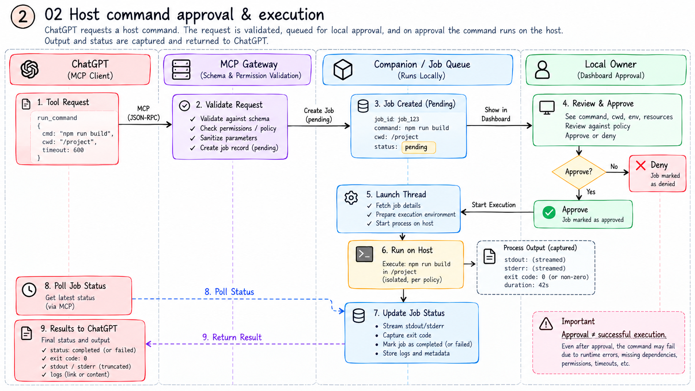

# Web-Bridge

**Connect ChatGPT to a project on your computer, with permissions controlled locally.**

Web-Bridge combines a private ChatGPT Site, an MCP gateway, and a Python companion. It can inspect a selected project, propose text edits, send requests to approved websites, and run locally approved commands on the host or in a temporary Docker container.

**Current version: 3.1.1** · Created by [admin12121](https://github.com/Admin12121) · [MIT license](LICENSE)

## How the connection works


This illustration describes the connection concept. In 3.1.1, Docker uses pre-pulled images and temporary project copies; it does not build images or attach development containers. Host commands use your OS account and are not confined to the selected project, despite the illustration's “safe shell commands” label. The [architecture reference](source/ARCHITECTURE.md) describes the implemented boundaries.

```text
ChatGPT + your Site-generated plugin
    → private Site / authenticated MCP gateway
    → authenticated HTTPS tunnel
    → Python companion on your computer
        ├─ selected project files
        ├─ approved HTTP/browser targets
        └─ approved Docker or host command jobs

Separate local control panel: project, permissions, approvals, pause
```

The companion enforces local permissions. The Site cannot choose a project, grant itself access, or approve a pending command. Only the authenticated RPC endpoint belongs behind a tunnel; the local control panel stays on loopback.

## What works today

| Area | Available in 3.1.1 | Current boundary |
| --- | --- | --- |
| Project files | List, literal search, UTF-8 reads and proposed edits; new files in existing directories | 256 KB/file; no folder creation, rename, deletion, or arbitrary binary editing |
| Host commands | Real process execution after exact local approval; status and output | Uses your OS account; approval is required for each command |
| Docker commands | Short-lived Linux containers using a filtered project snapshot | Engine and selected image must already be ready; no existing-container attachment |
| Approved websites | HTTP requests, forms, cookies, request history | Exact approved origins; redirects are not followed |
| Optional browser | Scoped Chromium actions | Local Playwright/Chromium installation required |
| Local controls | Select a project, permissions, edit/job approval, pause | Grants and queued work are session-scoped |

Commands are currently limited to 120 seconds, 64 KB of captured output, and 30 retained jobs per companion session. Docker changes are proposals unless session write permission is enabled; deleted snapshot files are not deleted in the real project. See [usage and limits](source/docs/usage.md).

**Known execution-reporting issue:** a job can return `completed` with a nonzero exit code. Check its exit code, output, and requested result before treating it as successful. This is documented for repair; it has not been fixed by the documentation update.

## Start the companion

You need **Python 3.10+**, [cloudflared](https://developers.cloudflare.com/tunnel/downloads/) for the remote connection, and your own private ChatGPT Site with its generated plugin. Account/workspace capabilities may vary. Docker is optional unless you want container commands.

1. Deploy your own private Site using the setup workflow described in [SETUP](source/SETUP.md). Importing a plugin alone does not deploy a Site.
2. Download `Web-Bridge.pyz` from your trusted release or private Site.
3. Start it on your computer:

   ```powershell
   # Windows
   python .\Web-Bridge.pyz
   ```

   ```sh
   # macOS / Linux
   python3 Web-Bridge.pyz
   ```

4. Open the printed local control panel. Enter its local control code, choose a project, and grant the capabilities you want.
5. Enter the printed Site endpoint and connection key **only in your private Site's connection form**.
6. Select your Site-generated plugin in ChatGPT. Call `bridge_status`, verify the chosen workspace, then test a read and a command result.

The bundle starts a Quick Tunnel by default. Add `--local-only` to run without a tunnel. Core companion features need no pip installation or extraction. Keep the companion running while ChatGPT uses it.

## Understand command execution



**Approval means permission to start; it does not prove execution succeeded.** Submit a command once with an idempotency key, approve it locally if required, then poll the returned job ID. Confirm the exit code and output, and inspect the expected file or service when relevant.

The illustration uses conceptual API names, a 600-second example, and an “isolated” host label. The actual API is `command_request` / `command_status`, the current ceiling is 120 seconds, and host mode is not isolated. Use the [actual tool examples](source/docs/usage.md), not the labels in the artwork.

For Docker today, start Docker Desktop in Linux-container mode, prepare one of the supported images, select it locally, and enable command requests. For example:

```sh
docker pull node:24-alpine
```

Supported selections are `python:3.12-alpine`, `node:24-alpine`, and `alpine:3.21`. The bridge does not pull an image automatically. Its local panel currently has no container connection wizard. [Docker setup and troubleshooting](source/docs/troubleshooting.md#docker-commands) explains the current process.

## Documentation

| Guide | Purpose |
| --- | --- |
| [Setup](source/SETUP.md) | First connection, Docker prerequisites, upgrades, verification |
| [Usage and tool examples](source/docs/usage.md) | File edits, commands, approvals, limits, expected results |
| [Troubleshooting](source/docs/troubleshooting.md) | No-effect commands, pending jobs, Docker and connection problems |
| [Architecture](source/ARCHITECTURE.md) | Source ownership, data flow, current lifecycle and boundaries |
| [Companion reference](source/bridge/README.md) | Launch options, local permissions, runtime data, browser setup |
| [Illustrated workflows](docs/illustrations.md) | All eight supplied diagrams, with implementation notes |
| [Upgrade direction](source/docs/roadmap.md) | Proposed project changes and both continuation modes |
| [Contributing](source/CONTRIBUTING.md) | Development, verification and packaging |
| [Security](source/SECURITY.md) | Permission model and private vulnerability reporting |

## Develop from the source

This checkout keeps canonical development code in **`source/`**. `Companion/`, `Plugin/`, and the root `.pyz` are generated distributions; rebuild them rather than editing their copies. Repository illustrations live in `docs/images/` and are kept out of the embedded setup package to avoid adding roughly 14 MB to the hosted worker.

```sh
cd source
npm ci
npm run check:repo
npm run build
npm run validate
npm test
python -m pip install pytest
python -m pytest -q bridge/tests
python scripts/package-release.py
```

Requires Node.js 22.13+ and Python 3.10+. On macOS/Linux use `python3` where needed. Builds go to `source/dist/` and `source/outputs/`. `python scripts/export-repository.py` exports a sanitized source-first checkout; it refuses to overwrite an existing export. Release `.pyz` and ZIP bundles as downloadable assets. Do not commit credentials, runtime folders, tunnel logs, or selected project data.

## Upgrade status

Reliable outcome reporting, complete file operations, persistent Docker development environments, local skill/MCP integrations, and durable task continuation are **proposed upgrades**, not capabilities of 3.1.1. Both ChatGPT resume and an optional local agent are in the [design for review](source/docs/superpowers/specs/2026-10-26-web-bridge-upgrade-design.md). The installed plugin will be updated after the project behavior is implemented and verified.

Only use the bridge with projects, applications, and targets you own or are authorized to work on. This project has not been independently security audited.
