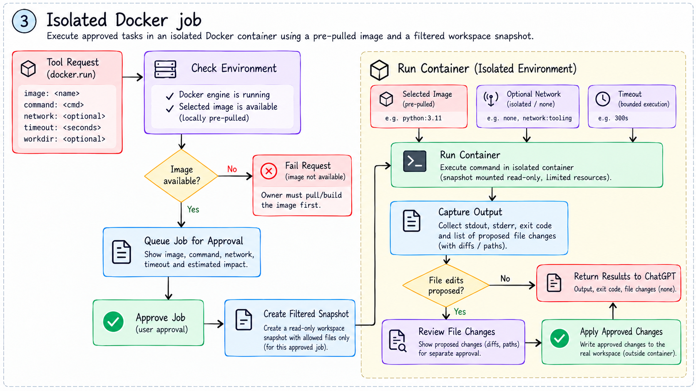
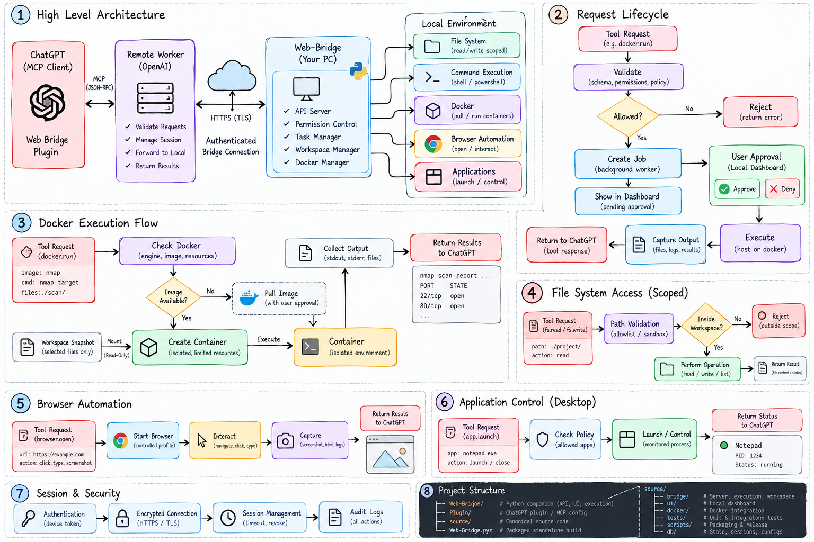

# Illustrated Web-Bridge workflows

[Project README](../README.md) · [Implemented architecture](../source/ARCHITECTURE.md) · [Actual tool examples](../source/docs/usage.md)

These eight owner-supplied illustrations are preserved without image edits and renamed by subject. They explain the intended workflow, but their embedded names, examples, and capability labels are not an API specification. The notes below identify where they differ from version 3.1.1.

## 1. System architecture

The request path is accurate at a high level. Docker image building is not implemented. “Safe shell commands” does not describe a security boundary: approved host commands run with the owner's OS-account access. The private Site runs on the existing Sites infrastructure; a separate self-hosted worker is not required by this project.

## 2. Host command lifecycle

Use `command_request` with an argument array, not `run_command` or a `cmd` string. The maximum timeout is 120 seconds, not the pictured 600. Host mode is not isolated. Output combines stdout and stderr. A `completed` state can currently accompany a nonzero exit code; confirm the exit code and observed effect. Local approval is not execution evidence.

## 3. Isolated Docker job

Use `command_request` with `environment: "container"`; there is no `docker.run` tool. The selected image must be one of the three supported pre-pulled images. The container root filesystem is read-only, but its filtered `/workspace` copy is writable so the job can propose text changes. The original project is not mounted. Current timeout is at most 120 seconds, not 300. Deletions and new nested folders do not sync back today.

## 4. Workspace edit lifecycle

Use `workspace_edit`, `text`, and `expected_sha256`. An existing file's hash is required to match; it is not optional for an overwrite. Omit the hash only when creating an absent file in an existing directory. Paths are relative without the pictured leading `/`. The operation is path-scoped; it is not a process isolation environment.

## 5. Approved HTTP request

The actual tool is `http_request`. `target` is the name configured locally, not necessarily its hostname. HTTP and HTTPS origins are supported; private/local lab targets need separate local opt-in. Requests do not follow redirects. Evidence and cookies are bounded session state, not an unlimited permanent archive.

## 6. Build, deploy and connect

Use `source/`, `npm run build`, and the documented packaging scripts; `scripts/build.sh`, a root `web-bridge.py`, and the pictured directory structure are illustrative. The worker is the Site gateway, not an autonomous long-running agent. The remote Site uses the printed authenticated HTTPS endpoint; do not enter a localhost example as its remote endpoint. Keys shown in this artwork are illustrative; never put real connection keys in a screenshot. Follow [SETUP](../source/SETUP.md).

## 7. Broader workflow concept

**Concept, not a current feature inventory.** A Docker manager, automatic pulls, desktop application screenshots/control, and an autonomous task manager are not implemented in 3.1.1. Permission decisions remain local; the gateway does not grant them. Application access will require selected adapters.

## 8. Expanded architecture concept

**Concept, not a current implementation specification.** Its automatic image preparation, desktop control, durable audit/session system, generic API names, and `source/ui` / `source/docker` layout are proposed concepts. Snapshot workspace mounts are writable, despite the pictured read-only label. See the [proposed upgrade direction](../source/docs/roadmap.md) for the selected staged approach.

## Original filename map

| Original filename | Organized filename |
| --- | --- |
| ChatGPT Image Oct 26, 2026, 02_18_40 AM-1.png | 01-system-architecture.png |
| ChatGPT Image Oct 26, 2026, 02_18_41 AM-2.png | 02-host-command-lifecycle.png |
| ChatGPT Image Oct 26, 2026, 02_18_42 AM-3.png | 03-docker-snapshot-job.png |
| ChatGPT Image Oct 26, 2026, 02_18_44 AM-4.png | 04-workspace-edit-lifecycle.png |
| ChatGPT Image Oct 26, 2026, 02_18_45 AM-5.png | 05-approved-http-request.png |
| ChatGPT Image Oct 26, 2026, 02_18_46 AM-6.png | 06-build-deploy-connect.png |
| Web Bridge Workflow Architecture Diagram.png | 07-expanded-workflow-concept.png |
| Web-Bridge Architecture Workflow Infographic.png | 08-expanded-architecture-concept.png |
